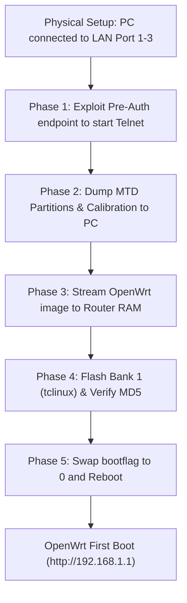

# Sercomm JioFiber JCOW414 - OpenWrt Installation Guide & Automation Tools

A comprehensive, automated toolkit and reference guide for installing OpenWrt on the **Sercomm JioFiber JCOW414** optical home gateway without opening the device case or soldering UART serial headers.

---

## Hardware Specifications

| Component | Specification |
| :--- | :--- |
| **Model** | Sercomm JioFiber JCOW414 |
| **SoC** | EcoNet / Airoha EN7528HU (Dual-Core MIPS 1004Kc @ 900 MHz) |
| **RAM** | 512 MB DDR3 |
| **Flash** | 128 MB SPI-NAND (Dual-Bank Architecture) |
| **Ethernet** | 4x Gigabit RJ45 via MediaTek MT7530 DSA Switch |
| **Wi-Fi 2.4 GHz** | MediaTek MT7603E (802.11b/g/n, 2T2R) |
| **Wi-Fi 5 GHz** | MediaTek MT7615E / MT7613BE (802.11a/n/ac VHT80, 2T2R) |
| **PON** | Integrated GPON MAC / transceiver interface |
| **USB** | 1x USB 2.0 / 3.0 Host Port |

---

## Dual-Bank Flash Layout

The JCOW414 features a dual-bank partition layout that ensures safe firmware updates:

| Bank | Partition Name | MTD Device | Description |
| :---: | :---: | :---: | :--- |
| **Bank 1** | `tclinux` | `mtd4` | Primary boot system (Target for OpenWrt) |
| **Bank 2** | `tclinux_slave` | `mtd7` | Secondary boot system (Stock firmware backup) |
| **Config** | `reservearea` | `mtd13` | Stores boot metadata and the active `boot_flag` |

By writing OpenWrt strictly to **Bank 1 (`tclinux`)** and toggling the boot flag, **Bank 2 (`tclinux_slave`)** remains completely untouched. This preserves the original stock firmware as a hardware-level recovery bank.

---

## Flashing Workflow Overview



1. **Root Access:** An unauthenticated command injection via HTTP headers spawns a root `telnetd` listener on port 23 and opens the local firewall.
2. **Partition Backup:** All essential NAND partitions (`mtd0` bootloader, `mtd1` calibration/MAC romfile, `mtd11` config, `mtd13` reservearea, and `/flash`) are dumped, archived, and streamed to the PC over a temporary TCP socket.
3. **Firmware Staging:** The OpenWrt squashfs-tclinux image is streamed over TCP into the router's RAM (`/tmp/fw.trx`), avoiding Windows Firewall blocks typical of local HTTP servers.
4. **Flashing:** The image is written to `tclinux` (`mtd -f write /tmp/fw.trx tclinux`).
5. **Bootflag Swap:** The active boot flag is toggled (`sys bootflag swap`) from `1` to `0` so the bootloader starts Bank 1 on next power-on.

---

## Requirements

- **Python 3.8+** (Uses only Python Standard Library modules; no external `pip` dependencies needed).
- **Ethernet Cable** connecting your PC to **LAN Port 1, 2, or 3** on the router (avoid Port 4 during flashing as it becomes WAN in OpenWrt).
- PC network interface configured to DHCP or static IP in the `192.168.29.x` subnet (e.g., `192.168.29.50`).
- OpenWrt firmware binary: `openwrt-jcow414-squashfs-tclinux.trx` (see [Downloads](#downloads)).

---

## Downloads

Download the OpenWrt firmware build for JCOW414:

- **Release:** [OpenWrt v23.05 for Sercomm JCOW414 v1.0.0 by UdayKhare09](https://github.com/UdayKhare09/jcow414-openwrt/releases/tag/v1.0.0)
- **Target File:** `openwrt-jcow414-squashfs-tclinux.trx`
- **SHA-256 Checksum:** `a4bd6d395eef67c12b66aa09f15def240ce4c9fdae5aadda159d286a04c317a4`

Place the downloaded `.trx` file in the root of this repository.

---

## Quick Start (Automated Pipeline)

Run the all-in-one automation script:

```bash
python scripts/flash_all.py --firmware openwrt-jcow414-squashfs-tclinux.trx
```

The script will automatically perform:
1. Exploit delivery and root shell verification.
2. Raw partition backup saved to `./backup/router_backup.tar.gz`.
3. Firmware upload into `/tmp/fw.trx` with SHA/MD5 verification.
4. Flash execution, bootflag swap to `0`, and device reboot.

---

## Step-by-Step Manual Execution

If you prefer running each phase individually:

### Step 1: Gain Root Shell
```bash
python scripts/exploit_root.py --target 192.168.29.1 --password password
```
This triggers the pre-auth exploit, starts `telnetd`, and configures root credentials (`root` / `password`).

### Step 2: Backup NAND Partitions & Calibration
```bash
python scripts/backup_partitions.py --target 192.168.29.1 --password password --outdir backup
```
Dumps `mtd0`, `mtd1`, `mtd11`, `mtd13`, and `/flash` to `backup/router_backup.tar.gz`. Verify this file is intact before proceeding.

### Step 3: Stream Firmware into Router RAM
```bash
python scripts/upload_firmware.py openwrt-jcow414-squashfs-tclinux.trx --target 192.168.29.1 --password password
```
Uploads the image to `/tmp/fw.trx` and verifies checksums match.

### Step 4: Flash Bank 1 & Swap Bootflag
```bash
python scripts/flash_and_swap.py --target 192.168.29.1 --password password
```
Flashes `tclinux`, executes `sys bootflag swap`, confirms `boot_flag = 0`, and reboots the router.

---

## Initial OpenWrt Configuration

Once the router restarts (approx. 60–90 seconds):

1. **Access Web Interface (LuCI):**
   Navigate to `http://192.168.1.1` in your browser. (No root password is set by default).
2. **Access via SSH:**
   ```bash
   ssh root@192.168.1.1
   ```
3. **Set Root Password:**
   ```bash
   passwd
   ```
4. **Port Layout in OpenWrt:**
   - **LAN Ports 1, 2, 3:** Internal LAN (`br-lan`)
   - **LAN Port 4:** Dedicated WAN Port (`wan`, DHCP client)

---

## Recovery / Rollback to Stock Firmware

If you ever wish to return to the factory Jio firmware:

1. Connect to the router via SSH:
   ```bash
   ssh root@192.168.1.1
   ```
2. Check the current boot flag:
   ```bash
   /usr/sbin/en75_chboot get
   ```
3. Switch back to Bank 2 (`tclinux_slave`):
   ```bash
   /usr/sbin/en75_chboot swap
   reboot
   ```
The device will boot back into the original stock firmware on `192.168.29.1`.

---

## References & Credits

This project references and builds upon research and tools developed by the community:

- **[JFxploit](https://github.com/JFC-Group/JFxploit)** by **JFC-Group** — Remote vulnerability research and exploitation framework for Jio devices.
- **[jcow414-openwrt](https://github.com/UdayKhare09/jcow414-openwrt)** by **UdayKhare09** — OpenWrt 23.05 firmware release and packaging for Sercomm JCOW414.
- **[jiofiber-jcow414-openwrt](https://github.com/Asjohn720/jiofiber-jcow414-openwrt)** by **Anand (@Asjohn720)** — Foundational Device Tree (`en7528-sercomm-jcow414.dts`), memory map research, and OpenWrt bring-up.
- **[@zke-7D6](https://github.com/zke-7D6)** & **[@gpsarathy](https://github.com/gpsarathy)** — Hardware teardown, UART pinout research, and firmware analysis.
- **[OpenWrt Project](https://openwrt.org/)** — Open-source Linux operating system for embedded routers.

---

## Disclaimer

This repository is provided for educational and research purposes only. Flashing third-party firmware modifies device storage and may void manufacturer warranties. Always keep a verified backup of your device's calibration and ROM partitions before flashing.
